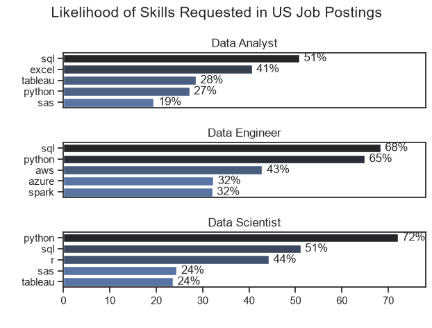
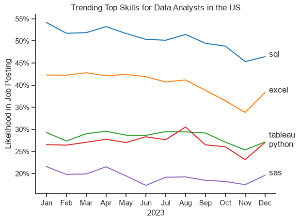
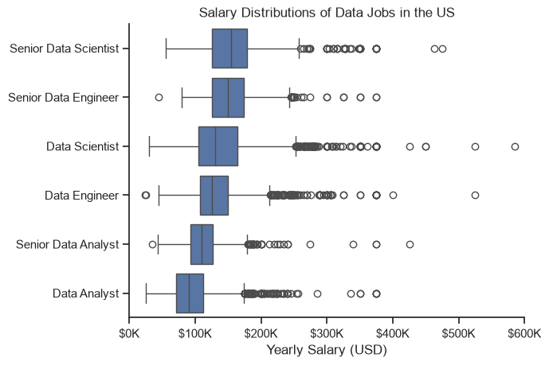
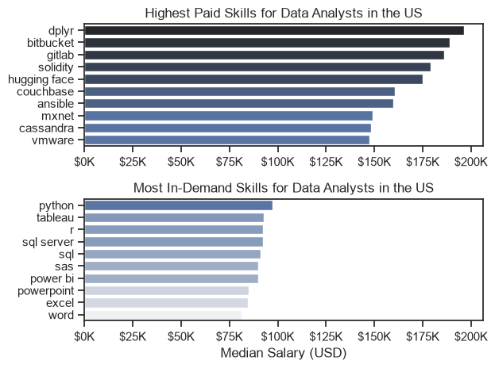

# The Analysis

## 1. What are the most demande skills for the top 3 most popular data roles?

To find the most demanded skilld for the top 3 most popular data roles, I filtered out those positions by which ones were the most popular, and got the top 5 skills for these top 3 roles.THis query highlights the most popular job titles and their top skills, showing which skills I should pay attention to depending on the role I'm targeting.

View my notebook with detailed steps here: 
[2_Skills_Count.ipynb](3_Project\2_Skills_Count.ipynb)

### Visualize Data

```python
fig, ax = plt.subplots(len(job_titles), 1) 

for i, job_title in enumerate(job_titles):
    df_plot = df_skills_perc[df_skills_perc["job_title_short"] == job_title].head(5) 
    df_plot.plot(kind="barh", x="job_skills", y="skill_percent", ax=ax[i], title=job_title)
    ax[i].invert_yaxis() # to invert y axis
    ax[i].set_ylabel(" ")
    ax[i].legend().set_visible(False) # to hide legend

fig.suptitle("Likelihood of Skills Requested in US Job Postings", fontsize=15)
fig.tight_layout(h_pad=0.5) # h_pad stands for height padding. It controls the vertical spacing between vertically adjacent (stacked) subplots. we fix it tp 0.5
plt.show()
```

### Results


### Insights

- Python is a versatile skill, highly demanded across all three roles, but most prominently for Data Scientists(72%) and Data Engineers(65%).
- SQL is the most requested skill for Data Analysts and Data Scientists, with it in over half the job postings for both roles. For Data Engineers, Python is the most sought-after skill, appearing in 68% of the job postings. 
- Data Engineers require more specialized technical skills (AWS, Azure, Spark) compared to Data Analysts and Data Scientists who are expected to be proficient in more general data management and analysis tools(Excel,  Tableau)


## 2. How are in-demand skills trending for Data Analysts?

### Visualize Data

```python
sns.lineplot(data=df_plot, dashes=False, palette="tab10") # to remove dashes and have solid lines instead
sns.set_theme(style="ticks")

plt.title('Trending Top Skills for Data Analysts in the US')
plt.ylabel('Likelihood in Job Posting')
plt.xlabel('2023')
plt.legend().remove()
```

### Results


### Insights
- SQL and Excel consistently lead as the top two most requested skills for US Data Analysts throughout 2023. SQL maintains the highest overall demand, staying above 50% for most of the year before dipping slightly to around 46% by December. Excel holds a firm second place (averaging 35%–42%), highlighting that foundational database querying and spreadsheet skills remain baseline requirements for the majority of job postings.
- Tableau and Python compete closely for the third spot, both fluctuating within the 25% to 30% range. Python shows more volatility across the year—peaking briefly above Tableau in August near 30%—before both skills converge at roughly 27% in December. This close trajectory reflects balanced employer demand for data visualization tools alongside programming capabilities.
- SAS trails as the least requested of the top five skills, hovering steadily between 17% and 22% throughout the year. Its lower baseline compared to open-source languages (Python) and business intelligence platforms (Tableau) illustrates a broader market shift toward modern, flexible analytics stacks over traditional proprietary software.


## 3. How well do jobs and skills pay for Data Analysts?

### Salary Analysis for Data Specilaists

```python
sns.boxplot(data=df_US_top6, x='salary_year_avg', y='job_title_short', order=job_order)
sns.set_theme(style='ticks')
sns.despine()

# this is all the same
plt.title('Salary Distributions of Data Jobs in the US')
plt.xlabel('Yearly Salary (USD)')
plt.ylabel('')
plt.xlim(0, 600000) 
ticks_x = plt.FuncFormatter(lambda y, pos: f'${int(y/1000)}K')
plt.gca().xaxis.set_major_formatter(ticks_x)
plt.show()
```
### Results


### Insights
1) Salary levels follow a clear vertical hierarchy driven by role complexity and seniority, with Data Analysts anchoring the bottom of the pay scale (median ~$90k) and Senior Data Analysts progressing to ~$110k. Moving to technical build and modeling roles yields a substantial jump, with Data Engineers and Data Scientists earning medians of ~$125k–$130k, while senior titles command median compensation packages around $150k–$155k.
2) Data Engineers and Data Scientists display nearly identical salary distributions at both the standard and senior tiers. Their interquartile ranges overlap heavily—mid-level roles hover between ~$105k and ~$160k, while senior roles span ~$125k to ~$175k—reflecting equal market valuation for building production data pipelines versus engineering machine learning models.
3) Every role exhibits strong right-skewed distributions with numerous high-end outliers extending far beyond the upper whiskers. While standard upper limits sit between $170k and $260k depending on the role, individual postings push into $300k–$400k+ territory across all disciplines, peaking near $600k for Data Science roles. This demonstrates that top-tier tech hubs, specialized domain expertise, and equity-heavy packages drive total compensation well above standard market medians.

### Highest Paid and Most Demanded Skills for Data Analysts

```python
fig, ax = plt.subplots(2, 1)  

# Top 10 Highest Paid Skills for Data Analysts
sns.barplot(data=df_DA_top_pay, x='median', y=df_DA_top_pay.index, hue='median', ax=ax[0], palette='dark:b_r')
ax[0].legend().remove()
# original code:
# df_DA_top_pay[::-1].plot(kind='barh', y='median', ax=ax[0], legend=False) 
ax[0].set_title('Highest Paid Skills for Data Analysts in the US')
ax[0].set_ylabel('')
ax[0].set_xlabel('')
ax[0].xaxis.set_major_formatter(plt.FuncFormatter(lambda x, _: f'${int(x/1000)}K'))


# Top 10 Most In-Demand Skills for Data Analysts')
sns.barplot(data=df_DA_skills, x='median', y=df_DA_skills.index, hue='median', ax=ax[1], palette='light:b')
ax[1].legend().remove()
# original code:
# df_DA_skills[::-1].plot(kind='barh', y='median', ax=ax[1], legend=False)
ax[1].set_title('Most In-Demand Skills for Data Analysts in the US')
ax[1].set_ylabel('')
ax[1].set_xlabel('Median Salary (USD)')
ax[1].set_xlim(ax[0].get_xlim())  # Set the same x-axis limits as the first plot
ax[1].xaxis.set_major_formatter(plt.FuncFormatter(lambda x, _: f'${int(x/1000)}K'))

sns.set_theme(style='ticks')
plt.tight_layout()
plt.show()
```



### Insights
1) There is zero overlap between the top 10 most in-demand skills and the top 10 highest-paying skills for Data Analysts in the US. While widely requested core skills (e.g., Python, Tableau, SQL, Excel) anchor the overall market, their broad adoption stabilizes median compensation within a modest $80k to $97k range. In contrast, rare specialized skills command a massive premium, with top-paying tools like dplyr ($195k) and bitbucket ($188k) fetching more than double the median salary of mainstream tools.
2) The highest-paid skills are overwhelmingly concentrated in niche data engineering, DevOps, AI/ML, and smart contract development. Advanced technologies such as gitlab (~$185k), solidity (~$178k), hugging face (~$175k), and ansible (~$160k) sit at the upper end of the spectrum. This demonstrates that Data Analysts who expand into software architecture, version control pipelines, and specialized AI modeling capture significantly higher market compensation than standard reporting roles.
3) The most in-demand skills exhibit extreme salary stability, spanning a tight $16k range from Microsoft Word ($81k) up to Python ($97k). Technical analysis tools like Python ($97k), R ($92k), SQL Server ($92k), and Tableau ($92k) slightly outperform general productivity software like Excel ($84k) and PowerPoint ($84k). However, because these tools form the baseline baseline for modern data roles, they serve primarily as entry requirements rather than differentiators for top-tier compensation.
