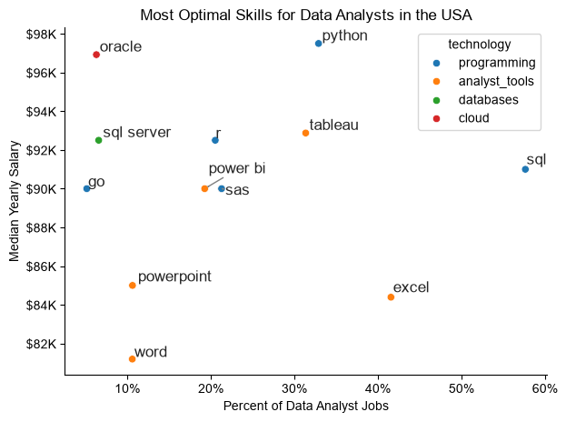

# Overview
Welcome to my data job market analysis project. Built while learning Python for Data Analysis from zero through Luke Barousse’s Python Course, this workflow provided hands-on experience with core Python tools that will also support my data analysis work in battery modeling. Utilizing the course dataset on job titles, compensation, geographic locations, and required skills, I engineered Python scripts to evaluate in-demand tools, salary distributions, and high-value skill intersections for data analysts.

# The Questions
Below are the questions I want to answer in my project:

1) What are the skills most in demand for the top 3 most popular data roles?
2) How are in-demand skills trending for Data Analysts?
3) How well do jobs and skills pay for Data Analysts?
4) What are the optimal skills for data analysts to learn? (High Demand AND High Paying)

# Tools I used
For my deep dive into the data analyst job market, I harnessed the power of several key tools:

- Python: The backbone of my analysis, allowing me to analyze the data and find critical insights.I also used the following Python libraries:
    - Pandas Library: This was used to analyze the data.
    - Matplotlib Library: I visualized the data.
    - Seaborn Library: Helped me create more advanced visuals.
- Jupyter Notebooks: The tool I used to run my Python scripts which let me easily include my notes and analysis.
- Visual Studio Code: My go-to for executing my Python scripts.
- Git & GitHub: Essential for version control and sharing my Python code and analysis, ensuring collaboration and project tracking.

# Data Preparation and Cleanup
This section outlines the steps taken to prepare the data for analysis, ensuring accuracy and usability.
## Import & Clean Up Data
I start by importing necessary libraries and loading the dataset, followed by initial data cleaning tasks to ensure data quality.

```python
# Importing Libraries
import ast
import pandas as pd
import seaborn as sns
from datasets import load_dataset
import matplotlib.pyplot as plt  

# Loading Data
dataset = load_dataset('lukebarousse/data_jobs')
df = dataset['train'].to_pandas()

# Data Cleanup
df['job_posted_date'] = pd.to_datetime(df['job_posted_date'])
df['job_skills'] = df['job_skills'].apply(lambda x: ast.literal_eval(x) if pd.notna(x) else x)
```


# The Analysis

## 1. What are the most demande skills for the top 3 most popular data roles?

To identify the most in-demand skills across the top 3 data roles, I filtered the dataset for the most popular positions and extracted the top 5 skills for each. This analysis highlights the leading job titles alongside their primary skill sets, clarifying which technical competencies to prioritize based on your target role.

View my notebook with detailed steps here: 
[2_Skills_Count.ipynb](3_Project/2_Skills_Count.ipynb)

### Visualize Data

```python
fig, ax = plt.subplots(len(job_titles), 1) 

for i, job_title in enumerate(job_titles):
    df_plot = df_skills_perc[df_skills_perc["job_title_short"] == job_title].head(5) 
    df_plot.plot(kind="barh", x="job_skills", y="skill_percent", ax=ax[i], title=job_title)
    ax[i].invert_yaxis() # to invert y axis
    ax[i].set_ylabel(" ")
    ax[i].legend().set_visible(False) # to hide legend

fig.suptitle("Likelihood of Skills Requested in US Job Postings", fontsize=15)
fig.tight_layout(h_pad=0.5) # h_pad stands for height padding. It controls the vertical spacing between vertically adjacent (stacked) subplots. we fix it tp 0.5
plt.show()
```

### Results

*Bar graph visualizing the salary for the top 3 data roles and their top 5 skills associated with each.*

### Insights

- Python is a versatile skill, highly demanded across all three roles, but most prominently for Data Scientists(72%) and Data Engineers(65%).
- SQL is the most requested skill for Data Analysts and Data Scientists, with it in over half the job postings for both roles. For Data Engineers, Python is the most sought-after skill, appearing in 68% of the job postings. 
- Data Engineers require more specialized technical skills (AWS, Azure, Spark) compared to Data Analysts and Data Scientists who are expected to be proficient in more general data management and analysis tools(Excel,  Tableau)


## 2. How are in-demand skills trending for Data Analysts?
To analyze 2023 skill trends for Data Analysts, I filtered for data analyst roles and grouped skill occurrences by the job posting month. This isolated the top 5 skills per month, tracking demand fluctuations throughout 2023.

View my notebook with detailed steps here: [3_Skills_Trend.ipynb](3_Project/3_Skills_Trend.ipynb)

### Visualize Data

```python
sns.lineplot(data=df_plot, dashes=False, palette="tab10") # to remove dashes and have solid lines instead
sns.set_theme(style="ticks")

plt.title('Trending Top Skills for Data Analysts in the US')
plt.ylabel('Likelihood in Job Posting')
plt.xlabel('2023')
plt.legend().remove()
```

### Results

*Bar graph visualizing the trending top skills for data analysts in the US in 2023.*

### Insights
- SQL and Excel consistently lead as the top two most requested skills for US Data Analysts throughout 2023. SQL maintains the highest overall demand, staying above 50% for most of the year before dipping slightly to around 46% by December. Excel holds a firm second place (averaging 35%–42%), highlighting that foundational database querying and spreadsheet skills remain baseline requirements for the majority of job postings.
- Tableau and Python compete closely for the third spot, both fluctuating within the 25% to 30% range. Python shows more volatility across the year—peaking briefly above Tableau in August near 30%—before both skills converge at roughly 27% in December. This close trajectory reflects balanced employer demand for data visualization tools alongside programming capabilities.
- SAS trails as the least requested of the top five skills, hovering steadily between 17% and 22% throughout the year. Its lower baseline compared to open-source languages (Python) and business intelligence platforms (Tableau) illustrates a broader market shift toward modern, flexible analytics stacks over traditional proprietary software.


## 3. How well do jobs and skills pay for Data Analysts?
To analyze the highest-paying roles and skills, I filtered the dataset for United States job postings and calculated their median salary. I first evaluated the salary distributions across core roles—such as Data Scientist, Data Engineer, and Data Analyst—to establish a benchmark for which positions command the highest compensation.

View my notebook with detailed steps here: [4_Salary_Analysis](3_Project/4_Salary_Analysis.ipynb)

### Salary Analysis for Data Specilaists

### Visualize Data

```python
sns.boxplot(data=df_US_top6, x='salary_year_avg', y='job_title_short', order=job_order)
sns.set_theme(style='ticks')
sns.despine()

# this is all the same
plt.title('Salary Distributions of Data Jobs in the US')
plt.xlabel('Yearly Salary (USD)')
plt.ylabel('')
plt.xlim(0, 600000) 
ticks_x = plt.FuncFormatter(lambda y, pos: f'${int(y/1000)}K')
plt.gca().xaxis.set_major_formatter(ticks_x)
plt.show()
```
### Results

*Box plot visualizing the salary distributions for the top 6 data job titles.*

### Insights
- Salary levels follow a clear vertical hierarchy driven by role complexity and seniority, with Data Analysts anchoring the bottom of the pay scale (median \~$90k) and Senior Data Analysts progressing to \~$110k. Moving to technical build and modeling roles yields a substantial jump, with Data Engineers and Data Scientists earning medians of \~$125k–$130k, while senior titles command median compensation packages around $150k–$155k.
- Data Engineers and Data Scientists display nearly identical salary distributions at both the standard and senior tiers. Their interquartile ranges overlap heavily—mid-level roles hover between \~$105k and \~$160k, while senior roles span \~$125k to \~$175k—reflecting equal market valuation for building production data pipelines versus engineering machine learning models.
- Every role exhibits strong right-skewed distributions with numerous high-end outliers extending far beyond the upper whiskers. While standard upper limits sit between $170k and $260k depending on the role, individual postings push into $300k–$400k+ territory across all disciplines, peaking near $600k for Data Science roles. This demonstrates that top-tier tech hubs, specialized domain expertise, and equity-heavy packages drive total compensation well above standard market medians.

### Highest Paid and Most Demanded Skills for Data Analysts

### Visualize Data
```python
fig, ax = plt.subplots(2, 1)  

# Top 10 Highest Paid Skills for Data Analysts
sns.barplot(data=df_DA_top_pay, x='median', y=df_DA_top_pay.index, hue='median', ax=ax[0], palette='dark:b_r')
ax[0].legend().remove()
# original code:
# df_DA_top_pay[::-1].plot(kind='barh', y='median', ax=ax[0], legend=False) 
ax[0].set_title('Highest Paid Skills for Data Analysts in the US')
ax[0].set_ylabel('')
ax[0].set_xlabel('')
ax[0].xaxis.set_major_formatter(plt.FuncFormatter(lambda x, _: f'${int(x/1000)}K'))


# Top 10 Most In-Demand Skills for Data Analysts')
sns.barplot(data=df_DA_skills, x='median', y=df_DA_skills.index, hue='median', ax=ax[1], palette='light:b')
ax[1].legend().remove()
# original code:
# df_DA_skills[::-1].plot(kind='barh', y='median', ax=ax[1], legend=False)
ax[1].set_title('Most In-Demand Skills for Data Analysts in the US')
ax[1].set_ylabel('')
ax[1].set_xlabel('Median Salary (USD)')
ax[1].set_xlim(ax[0].get_xlim())  # Set the same x-axis limits as the first plot
ax[1].xaxis.set_major_formatter(plt.FuncFormatter(lambda x, _: f'${int(x/1000)}K'))

sns.set_theme(style='ticks')
plt.tight_layout()
plt.show()
```
### Results 

*Two separate bar graphs visualizing the highest paid skills and most in-demand skills for data analysts in the US.*

### Insights
- There is zero overlap between the top 10 most in-demand skills and the top 10 highest-paying skills for Data Analysts in the US. While widely requested core skills (e.g., Python, Tableau, SQL, Excel) anchor the overall market, their broad adoption stabilizes median compensation within a modest $80k to $97k range. In contrast, rare specialized skills command a massive premium, with top-paying tools like dplyr ($195k) and bitbucket ($188k) fetching more than double the median salary of mainstream tools.
- The highest-paid skills are overwhelmingly concentrated in niche data engineering, DevOps, AI/ML, and smart contract development. Advanced technologies such as gitlab (\~$185k), solidity (\~$178k), hugging face (\~$175k), and ansible (\~$160k) sit at the upper end of the spectrum. This demonstrates that Data Analysts who expand into software architecture, version control pipelines, and specialized AI modeling capture significantly higher market compensation than standard reporting roles.
- The most in-demand skills exhibit extreme salary stability, spanning a tight $16k range from Microsoft Word ($81k) up to Python ($97k). Technical analysis tools like Python ($97k), R ($92k), SQL Server ($92k), and Tableau ($92k) slightly outperform general productivity software like Excel ($84k) and PowerPoint ($84k). However, because these tools form the baseline baseline for modern data roles, they serve primarily as entry requirements rather than differentiators for top-tier compensation.

## 4. What is the most optimal skill to learn for Data Analysts?
To pinpoint the most optimal skills to learn—those combining high market demand with top-tier compensation—I calculated the percentage of skill demand alongside the median salary for each skill. This dual-metric approach cleanly highlights high-value technical skills to prioritize for career growth.

View my notebook with detailed steps here: [5_Optimal_Skills.ipynb](3_Project/5_Optimal_Skills.ipynb)

### Visualize Data

```python
from adjustText import adjust_text

df_DA_skills_high_demand.plot(kind='scatter', x='skill_percent', y='median_salary')

texts = [] # creating an empty list

for i, txt in enumerate(df_DA_skills_high_demand.index):
    texts.append(plt.text(df_DA_skills_high_demand['skill_percent'].iloc[i], df_DA_skills_high_demand['median_salary'].iloc[i], txt)) # appending this to texts list

adjust_text(texts, arrowprops=dict(arrowstyle='->', color='grey', lw=1))

plt.xlabel('Percent of Data Analyst Jobs')
plt.ylabel('Median Yearly Salary')
plt.title("Most Optimal Skills for Data Analysts in the USA")

from matplotlib.ticker import PercentFormatter
ax = plt.gca()
ax.yaxis.set_major_formatter(plt.FuncFormatter(lambda y, pos: f'${int(y/1000)}K'))
ax.xaxis.set_major_formatter(PercentFormatter(decimals=0))

plt.tight_layout()
plt.show()
```
### Results

*A scatter plot visualizing the most optimal skills (high paying & high demand) for data analysts in the US with color labels for technology.*

### Insights
- Python occupies the optimal top-right quadrant on the chart, combining high market demand (\~33%) with the highest median salary among major skills (\~$97.5K). Unlike niche skills that pay well but offer few openings, Python provides both widespread job availability and top-tier earning potential, making it the single most valuable technical skill for analysts to master.
- SQL dominates overall market presence by appearing in nearly 58% of all job postings while maintaining a strong \~$91K median salary. Excel also commands substantial volume (\~42% demand), but anchors the lower end of the compensation scale at \~$84.5K alongside general office tools like PowerPoint (\~$85K) and Word (\~$81K). This demonstrates that while spreadsheet tools remain a requirement for entry, querying languages like SQL are necessary to cross into higher salary brackets.
- Business intelligence tools like Tableau (\~31% demand, \~$93K) and Power BI (\~19% demand, \~$90K) form a stable mid-tier balancing solid salaries with steady job volume. Conversely, specialized cloud/database skills like Oracle achieve premium compensation (\~$97K) despite low overall market demand (\~6%), showing that niche technical specialization can yield salaries comparable to programming languages like Python even with fewer available job postings.


# What I learned
- **Python Progression (Basics to Advanced)**
  - Mastered core Python fundamentals from scratch before moving into data science libraries.
  - Utilized **Pandas** for complex operations like reshaping data, filtering, and pivoting.
  - Designed custom data visualizations using **Seaborn** and **Matplotlib**.
- **Data Cleaning & Transformation**
  - Applied `.explode()` to unpack list-type skill data for granular counting.
  - Handled missing salary entries with `.dropna()` to maintain dataset integrity.
  - Used `.merge()` and `.div()` to compute accurate percentage demand across job titles.
- **Strategic Market Insights**
  - Analyzed the interplay between high demand and high salary to identify sweet-spot skills.
  - Mapped compensation distributions using boxplots to understand baseline versus outlier pay tiers.


# Challenges I faced

 Learning Python from scratch made fine-tuning plot aesthetics—such as precise label offsets, axis formatters, and multi-panel layouts—very complicated. While foundational data manipulation clicked over time, implementing advanced custom tweaks in Seaborn and Matplotlib remains a challenging area that requires continuous practice.

 # Conclusion:
This exploration into the data analyst job market highlighted the key skills and salary trends essential for navigating the field. Completing this project in just one month alongside intensive university coursework—backed by hands-on practice—has been a major milestone. Although advanced visual customization is still a work in progress where AI can assist with fine-tuning, the real success is mastering Python's core logic for data analysis. I can now read, write, and debug Python code independently, building a strong foundation for future analytical projects.
